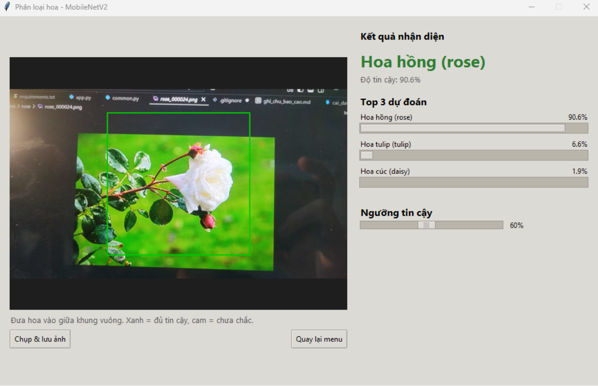

# Flower Classification with MobileNetV2

**English** | [Tiếng Việt](README.vi.md)

Classify 5 types of flowers (daisy, dandelion, rose, sunflower, tulip) with **MobileNetV2** and transfer learning (PyTorch, GPU supported).
The project includes a desktop app that recognizes flowers from an image file, a laptop camera, or a phone camera. After training, charts and reports are saved automatically.



## Results

Evaluated on the test set (430 images, never used for training or model selection):

| Metric | Value |
|---|---|
| Accuracy | **91.16%** (392 / 430) |
| Macro F1 | **0.912** |

| Class | Precision | Recall | F1 | Images |
|---|---|---|---|---|
| daisy | 0.957 | 0.868 | 0.910 | 76 |
| dandelion | 0.868 | 0.943 | 0.904 | 105 |
| sunflower | 0.971 | 0.904 | 0.936 | 73 |
| tulip | 0.887 | 0.959 | 0.922 | 98 |
| rose | 0.918 | 0.859 | 0.887 | 78 |

| Training history | Confusion matrix |
|---|---|
|  |  |

- Fine-tuning raises validation accuracy from about 0.89 to about 0.92.
- Mild overfitting: train accuracy is about 97%, validation about 91.5%.
- Most common mistakes: rose → tulip (9), daisy → dandelion (8), sunflower → dandelion (5). Some wrongly predicted images also have doubtful labels in the original data.

More examples: [`sample_predictions.png`](reports/run_20261020_171820/sample_predictions.png).

## Dataset

- Source: Kaggle flower images dataset (link: https://www.kaggle.com/datasets/alxmamaev/flowers-recognition).
- 5 classes, 4323 images in `data/flowers/<class_name>/`.
- Split with three CSV files (columns `Filename`, `Label`, `ClassName`):

| Set | Images |
|---|---|
| train | 3024 |
| validation | 860 |
| test | 430 |

`check_data.py` verifies that there are no broken images and no overlap between the three sets.

## Method

- **Model:** MobileNetV2 pretrained on ImageNet. The last layer is replaced by `Dropout(0.2) + Linear(1280 → 5)`. Input size 224×224.
- **Two-stage training:**
  1. Freeze the backbone, train only the new classifier: 5 epochs, lr `1e-3`.
  2. Fine-tune blocks 14–18 and the classifier: 10 epochs, lr `1e-4`.
- **Augmentation (train only):** random resized crop, horizontal flip, rotation ±20°, color jitter.
- **Other:** AdamW, mixed precision (FP16) on GPU, the weights with the lowest validation loss are kept.

All hyperparameters are at the top of `common.py`.

## Project structure

```
deep-learning-flower-classification/
├── common.py          # shared config and functions (paths, hyperparameters, model)
├── train.py           # training + evaluation + charts
├── app.py             # app: image file / laptop camera / phone camera
├── check_data.py      # check the data before training
├── find_errors.py     # find images the model gets wrong, for demos
├── requirements.txt
├── data/
│   ├── flowers/       # daisy/ dandelion/ rose/ sunflower/ tulip/
│   └── train.csv, validation.csv, test.csv
├── models/            # flower_model.pt (trained model)
├── reports/           # run_<time>/ charts + reports (created by train.py)
├── captures/          # photos saved from the camera (created by app.py)
├── demo_errors/       # wrong predictions copied by find_errors.py
└── docs/              # cai_dat_gpu.md, ghi_chu_bao_cao.md (in Vietnamese)
```

## Setup

Tested with Python 3.14.2 on Windows (VS Code, PowerShell).

```powershell
git clone https://github.com/anhtuanp-99/deep-learning-flower-classification.git
cd deep-learning-flower-classification

python -m venv venv
.\venv\Scripts\Activate.ps1
pip install torch torchvision --index-url https://download.pytorch.org/whl/cu126
pip install -r requirements.txt
python -c "import torch; print(torch.cuda.is_available())"     # True means the GPU works
```

- The trained model `models/flower_model.pt` is included, so you can run the app without training.
- To train again, download the dataset and put the images and CSV files under `data/` as shown above.
- GPU details and common errors: [docs/cai_dat_gpu.md](docs/cai_dat_gpu.md) (Vietnamese).

## Usage

| Task | Command |
|---|---|
| Check the data | `python check_data.py` |
| Train + save reports | `python train.py` |
| Open the app | `python app.py` |
| Find wrongly predicted images (for demos) | `python find_errors.py` |

Change the number of epochs, batch size, and learning rate at the top of `common.py`.

In the app you can choose an image, open the laptop camera, or open the phone camera. The app shows the top 3 predictions, and a **confidence threshold** slider: below the threshold it shows "Not sure". Camera results are averaged over the last 5 predictions. The capture button saves the photo to `captures/`.

### Phone camera (IP Webcam)

1. Install **IP Webcam** (Android) on your phone and tap **Start server**. The screen shows an address like `http://192.168.1.5:8080`.
2. The phone and the laptop must be on the **same Wi-Fi network** (not mobile data). Check by opening that address in your laptop browser.
3. Open `app.py` and set the address at the top of the file (`http://` and `/video` are optional):
   ```python
   PHONE_CAMERA_URL = "192.168.1.5:8080"
   ```
4. Run `python app.py` and click **Open phone camera**.

If the video is delayed, lower the resolution in IP Webcam (Video preferences). For iPhone, use an MJPEG streaming app and enter the full stream URL in `PHONE_CAMERA_URL`. The address changes when you change networks.

### Find wrong predictions for demos

```powershell
python find_errors.py                   # scan the test set
python find_errors.py --min-conf 0.6    # only wrong cases where the model is confident
python find_errors.py --split all       # scan train + validation + test
```

The list is printed on screen. Wrong images are copied to `demo_errors/` with a `danh_sach.csv` file.

## Limitations

- Mild overfitting (train ~97%, validation ~91.5%).
- The data has some noisy labels and hard images.
- The model knows only 5 classes. Other objects are still assigned to one of them; the confidence threshold reduces this but does not remove it.
- Camera results can be worse than the test set because of different lighting and backgrounds.
- No comparison with other models yet (for example ResNet-50, EfficientNet).

## Authors

- Phạm Anh Tuấn ([@anhtuanp-99](https://github.com/anhtuanp-99))
- Phạm Hoài An

Course project for **Deep Learning**.

## License

MIT. Dataset images follow the license of their original source.

## References

- M. Sandler et al., *MobileNetV2: Inverted Residuals and Linear Bottlenecks*, CVPR 2018.
- [torchvision MobileNetV2](https://pytorch.org/vision/stable/models/mobilenetv2.html)