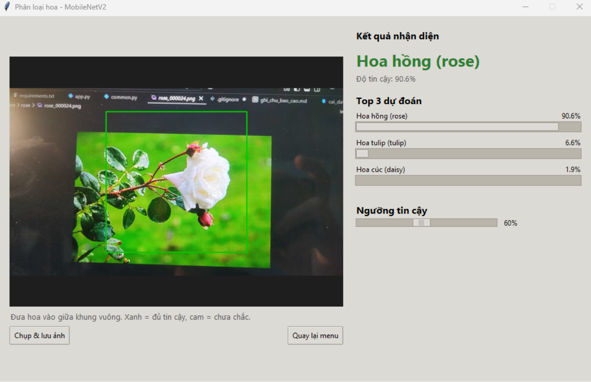

# Phân loại hoa bằng MobileNetV2

[English](README.md) | **Tiếng Việt**

Nhận diện 5 loài hoa (daisy, dandelion, rose, sunflower, tulip) bằng **MobileNetV2** và Transfer Learning (PyTorch, chạy được trên GPU).
Có giao diện nhận diện từ file ảnh, camera laptop hoặc camera điện thoại. Sau khi train, biểu đồ và báo cáo được lưu tự động.



## Kết quả

Đánh giá trên tập test (430 ảnh, chưa từng dùng khi huấn luyện hay chọn mô hình):

| Chỉ số | Giá trị |
|---|---|
| Accuracy | **91.16%** (392 / 430) |
| Macro F1 | **0.912** |

| Lớp | Precision | Recall | F1 | Số ảnh |
|---|---|---|---|---|
| daisy | 0.957 | 0.868 | 0.910 | 76 |
| dandelion | 0.868 | 0.943 | 0.904 | 105 |
| sunflower | 0.971 | 0.904 | 0.936 | 73 |
| tulip | 0.887 | 0.959 | 0.922 | 98 |
| rose | 0.918 | 0.859 | 0.887 | 78 |

| Biểu đồ huấn luyện | Confusion matrix |
|---|---|
|  |  |

- Fine-tune giúp validation accuracy tăng từ khoảng 0.89 lên khoảng 0.92.
- Có overfit nhẹ: train accuracy khoảng 97%, validation khoảng 91.5%.
- Nhầm nhiều nhất: rose → tulip (9), daisy → dandelion (8), sunflower → dandelion (5). Một số ảnh đoán sai còn có nhãn đáng ngờ trong dữ liệu gốc.

Thêm ví dụ: [`sample_predictions.png`](reports/run_20261020_171820/sample_predictions.png).

## Dữ liệu

- Nguồn: bộ ảnh hoa trên Kaggle (link: _sẽ bổ sung_).
- 5 lớp, 4323 ảnh trong `data/flowers/<tên_loài>/`.
- Chia tập bằng 3 file CSV (cột `Filename`, `Label`, `ClassName`):

| Tập | Số ảnh |
|---|---|
| train | 3024 |
| validation | 860 |
| test | 430 |

`check_data.py` kiểm tra không có ảnh hỏng và không có ảnh trùng giữa 3 tập.

## Phương pháp

- **Mô hình:** MobileNetV2 pretrain trên ImageNet. Thay lớp cuối bằng `Dropout(0.2) + Linear(1280 → 5)`. Ảnh vào 224×224.
- **Huấn luyện 2 giai đoạn:**
  1. Đóng băng backbone, chỉ train lớp phân loại mới: 5 epoch, lr `1e-3`.
  2. Fine-tune block 14–18 và lớp phân loại: 10 epoch, lr `1e-4`.
- **Augmentation (chỉ tập train):** random resized crop, lật ngang, xoay ±20°, đổi màu.
- **Khác:** AdamW, mixed precision (FP16) trên GPU, giữ trọng số có validation loss thấp nhất.

Toàn bộ siêu tham số nằm ở đầu file `common.py`.

## Cấu trúc

```
deep-learning-flower-classification/
├── common.py          # cấu hình + hàm dùng chung (đường dẫn, siêu tham số, model)
├── train.py           # huấn luyện + đánh giá + xuất biểu đồ
├── app.py             # giao diện: chọn ảnh / camera laptop / camera điện thoại
├── check_data.py      # kiểm tra dữ liệu trước khi train
├── find_errors.py     # lọc các ảnh model đoán sai để in ra demo
├── requirements.txt
├── data/
│   ├── flowers/       # daisy/ dandelion/ rose/ sunflower/ tulip/
│   └── train.csv, validation.csv, test.csv
├── models/            # flower_model.pt (mô hình đã train)
├── reports/           # run_<thời gian>/ biểu đồ + báo cáo (tự tạo)
├── captures/          # ảnh chụp từ camera (tự tạo)
├── demo_errors/       # ảnh đoán sai do find_errors.py chép ra
└── docs/              # cai_dat_gpu.md, ghi_chu_bao_cao.md
```

## Cài đặt

Đã thử với Python 3.14.2 trên Windows (VS Code, PowerShell).

```powershell
git clone https://github.com/anhtuanp-99/deep-learning-flower-classification.git
cd deep-learning-flower-classification

python -m venv venv
.\venv\Scripts\Activate.ps1
pip install torch torchvision --index-url https://download.pytorch.org/whl/cu126
pip install -r requirements.txt
python -c "import torch; print(torch.cuda.is_available())"     # ra True là GPU hoạt động
```

- Mô hình đã train `models/flower_model.pt` có sẵn trong repo, nên có thể chạy app mà không cần train lại.
- Muốn train lại, tải dữ liệu rồi đặt ảnh và các file CSV vào `data/` theo cấu trúc ở trên.
- Chi tiết về GPU và cách xử lý lỗi thường gặp: [docs/cai_dat_gpu.md](docs/cai_dat_gpu.md).

## Chạy

| Việc cần làm | Lệnh |
|---|---|
| Kiểm tra dữ liệu | `python check_data.py` |
| Huấn luyện + xuất báo cáo | `python train.py` |
| Mở giao diện nhận diện | `python app.py` |
| Lọc ảnh đoán sai để in demo | `python find_errors.py` |

Chỉnh số epoch, batch size, learning rate ở đầu file `common.py`.

Trong app có thể chọn ảnh, mở camera laptop hoặc camera điện thoại. App hiện Top 3 dự đoán và có thanh chỉnh **ngưỡng tin cậy**: dưới ngưỡng sẽ báo "Không chắc chắn". Kết quả camera là trung bình của 5 lần dự đoán gần nhất. Nút chụp lưu ảnh vào `captures/`.

### Camera điện thoại (IP Webcam)

1. Cài app **IP Webcam** (Android) trên điện thoại, bấm **Start server**. Màn hình hiện địa chỉ dạng `http://192.168.1.5:8080`.
2. Điện thoại và laptop phải **cùng mạng Wi-Fi** (không dùng 4G/5G). Kiểm tra bằng cách mở địa chỉ đó trên trình duyệt laptop.
3. Mở `app.py`, điền địa chỉ vào biến ở đầu file (gõ thiếu `http://` và `/video` cũng được):
   ```python
   PHONE_CAMERA_URL = "192.168.1.5:8080"
   ```
4. Chạy `python app.py` và bấm **Mở camera điện thoại**.

Luồng hình bị trễ thì giảm độ phân giải trong cài đặt của app IP Webcam (Video preferences). Với iPhone, dùng app phát luồng MJPEG và điền đầy đủ URL luồng vào `PHONE_CAMERA_URL`. Địa chỉ sẽ thay đổi khi đổi mạng.

### Lọc ảnh đoán sai để demo

```powershell
python find_errors.py                   # quét tập test
python find_errors.py --min-conf 0.6    # chỉ lấy ca sai mà model "tự tin"
python find_errors.py --split all       # quét cả train + validation + test
```

Danh sách được in ra màn hình, ảnh sai được chép vào `demo_errors/` cùng file `danh_sach.csv`.

## Hạn chế

- Overfit nhẹ (train ~97%, validation ~91.5%).
- Dữ liệu có một số nhãn nhiễu và ảnh khó.
- Mô hình chỉ biết 5 lớp. Vật khác vẫn bị gán vào một trong 5 lớp; ngưỡng tin cậy chỉ giảm chứ không loại hết được.
- Kết quả camera có thể kém hơn tập test vì khác ánh sáng và nền.
- Chưa so sánh với mô hình khác (ví dụ ResNet-50, EfficientNet).

## Tác giả

- Phạm Anh Tuấn ([@anhtuanp-99](https://github.com/anhtuanp-99))
- Phạm Hoài An

Bài tập của môn **Deep Learning**.

## Giấy phép

MIT. Ảnh dữ liệu tuân theo giấy phép của nguồn gốc.

## Tài liệu tham khảo

- M. Sandler et al., *MobileNetV2: Inverted Residuals and Linear Bottlenecks*, CVPR 2018.
- [torchvision MobileNetV2](https://pytorch.org/vision/stable/models/mobilenetv2.html)
